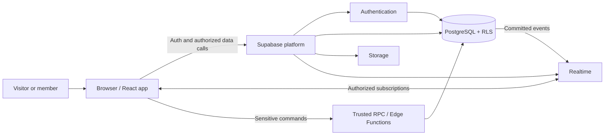
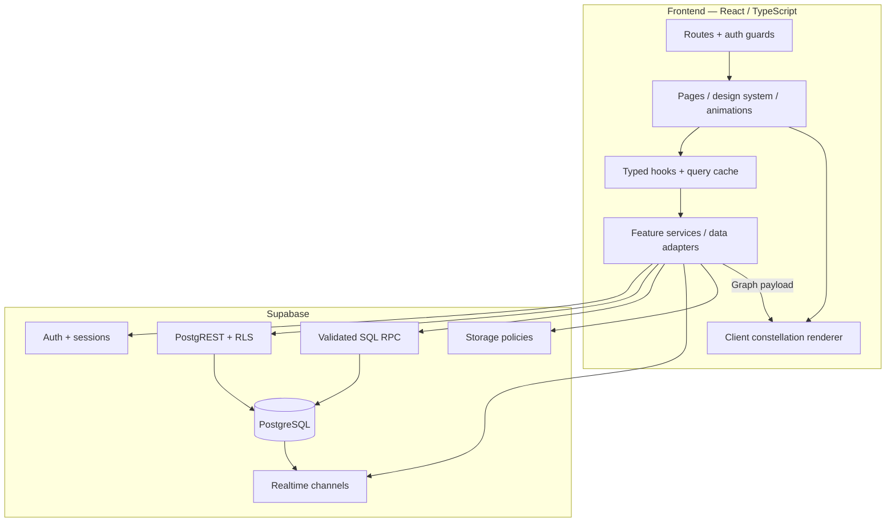
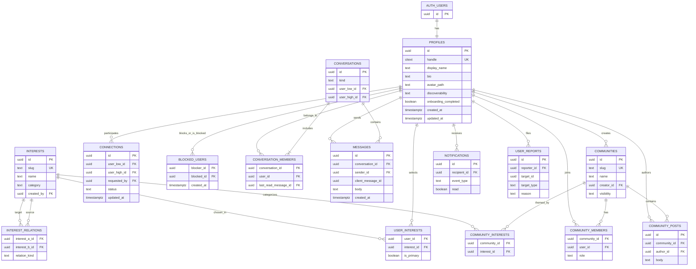
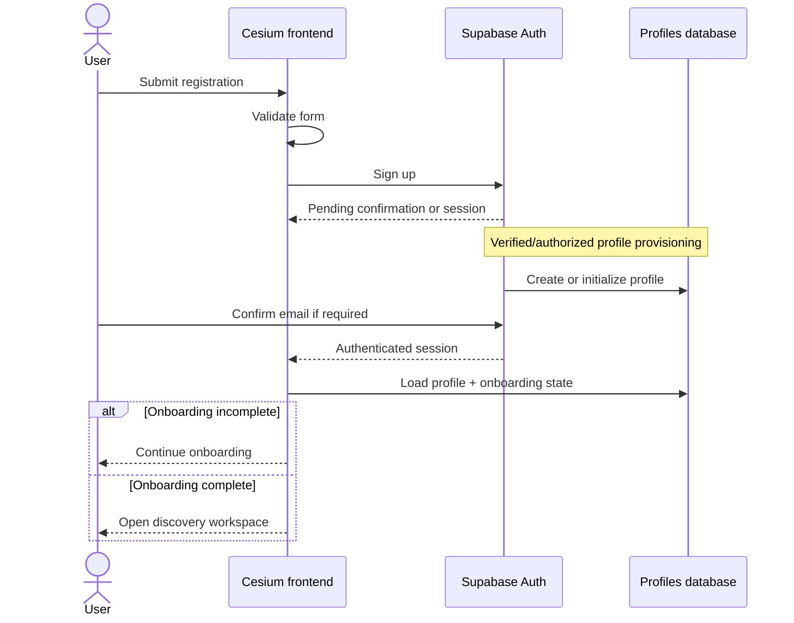
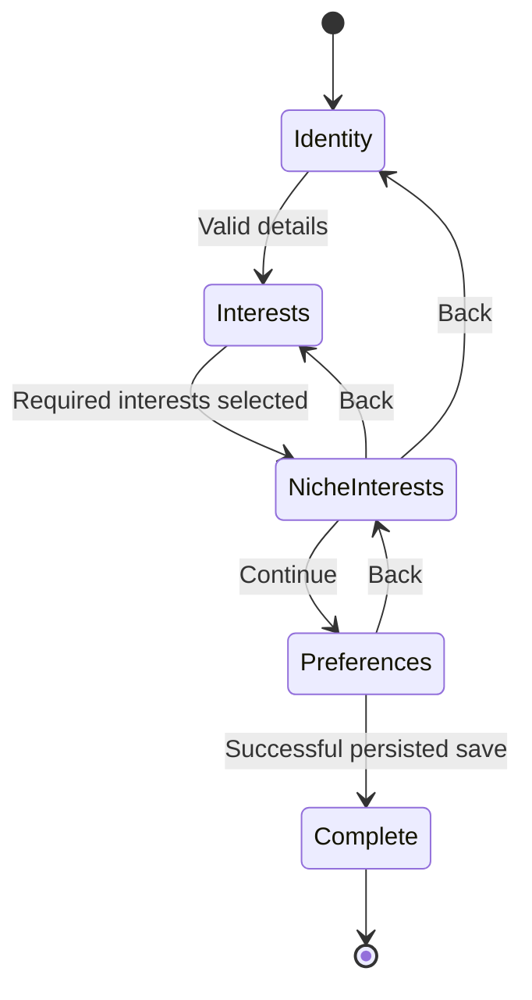
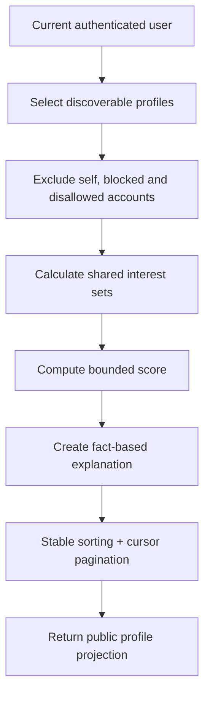
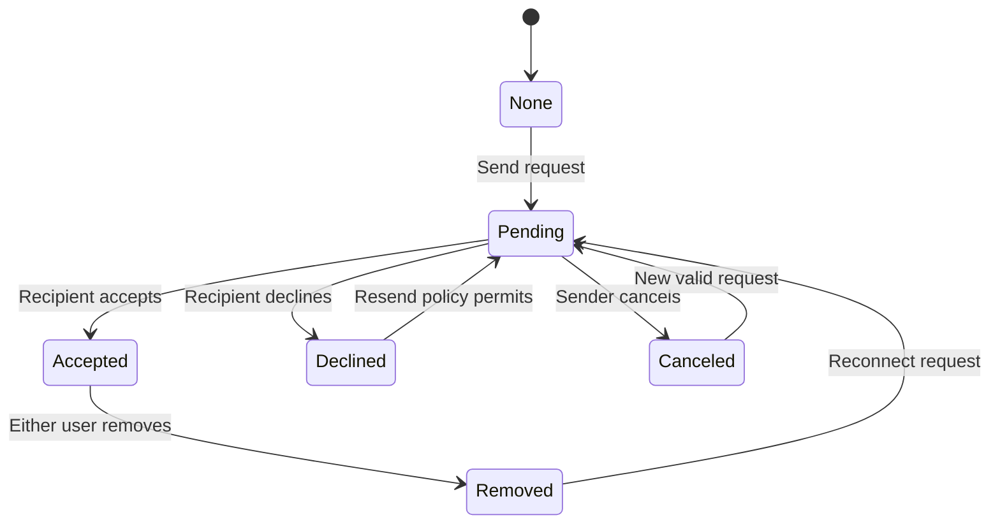
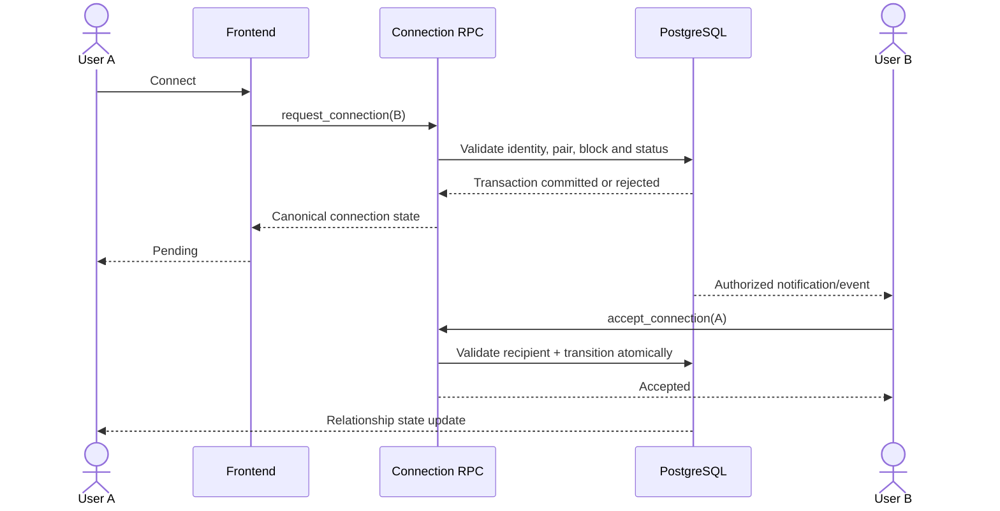
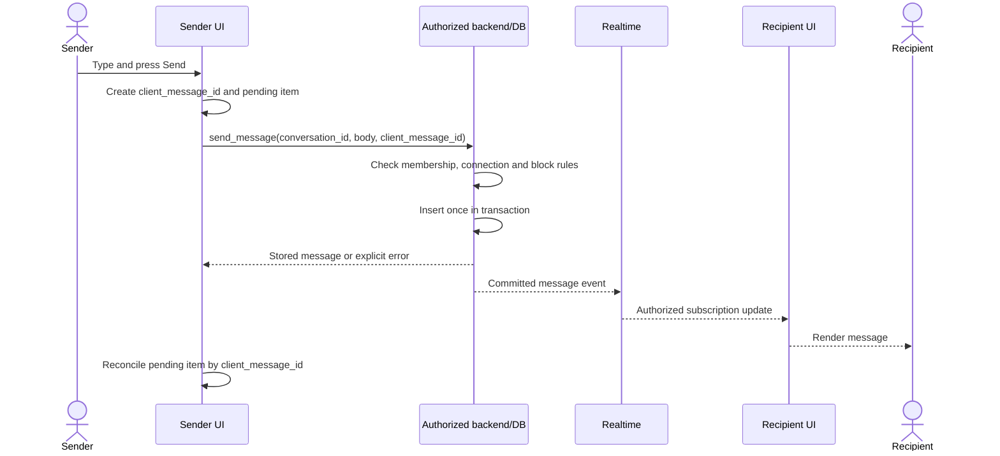
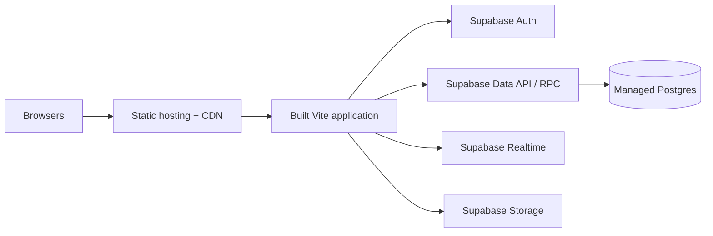

<div align="center">

# CESIUM

### Different atoms. Unexpected bonds.

**Find your frequency.**

_A social discovery platform for the interestingly different._

`CS / 055` · `BLACK / ACID GREEN / OFF-WHITE` · `INTERESTS → OVERLAPS → CONNECTIONS`

</div>

---

> [!IMPORTANT]
> **Project status — architecture blueprint, not a verified implementation.** This README describes the intended product, technical architecture, data model, security boundaries, and delivery plan based on the Cesium project specification. It **does not** claim that its features, migrations, tests, or integrations already exist. Before using the commands or folder paths below, reconcile them with the actual repository and update the [Implementation Status](#implementation-status) section.

## Contents

1. [What is Cesium?](#what-is-cesium)
2. [Product principles and scope](#product-principles-and-scope)
3. [Signature features](#signature-features)
4. [Experience and visual design](#experience-and-visual-design)
5. [Information architecture and routes](#information-architecture-and-routes)
6. [System architecture](#system-architecture)
7. [Frontend architecture](#frontend-architecture)
8. [Backend architecture](#backend-architecture)
9. [Database architecture](#database-architecture)
10. [Authentication and onboarding](#authentication-and-onboarding)
11. [Interest Constellation](#interest-constellation)
12. [Overlap Engine and matching](#overlap-engine-and-matching)
13. [Connections and relationship lifecycle](#connections-and-relationship-lifecycle)
14. [Realtime messaging](#realtime-messaging)
15. [Micro-communities](#micro-communities)
16. [Security, privacy, and trust](#security-privacy-and-trust)
17. [API and service contracts](#api-and-service-contracts)
18. [Environment and local development](#environment-and-local-development)
19. [Deployment and operations](#deployment-and-operations)
20. [Testing strategy](#testing-strategy)
21. [Performance and accessibility](#performance-and-accessibility)
22. [Development roadmap](#development-roadmap)
23. [Definition of done](#definition-of-done)
24. [Implementation status](#implementation-status)
25. [Architecture decisions and future work](#architecture-decisions-and-future-work)
26. [Glossary](#glossary)

---

# What is Cesium?

Most social platforms begin with an existing relationship: _Who do you already know?_ Cesium starts from curiosity: **Who else cares about the things you care about?**

Cesium is a social discovery experience built around hobbies, obscure interests, creative obsessions, and meaningful points of overlap. Rather than present a list of strangers with unexplained compatibility percentages, it shows **what two people have in common**, **why a conversation might be interesting**, and **where communities form around unusual combinations of interests**.

The name evokes the chemical element cesium (`Cs`, atomic number `55`): a distinctive scientific identity that becomes an abstract graphic language of nodes, bonds, reactions, and frequencies. The platform itself is not a science network; the scientific metaphor gives its social interactions a coherent identity.

| Attribute                  | Definition                                                                        |
| -------------------------- | --------------------------------------------------------------------------------- |
| **Product name**           | Cesium                                                                            |
| **Brand shorthand**        | `CS / 055`                                                                        |
| **Category**               | Interest-based social discovery                                                   |
| **Primary promise**        | Find people through genuine, explainable common ground                            |
| **Initial audience**       | Creators, developers, musicians, curious thinkers, and niche-interest enthusiasts |
| **Brand voice**            | Curious, unconventional, intelligent, welcoming, human                            |
| **Primary interaction**    | Explore interests → discover overlaps → connect → converse                        |
| **Visual palette**         | Near-black, acid/neon green, warm off-white                                       |
| **Initial launch posture** | One focused community before broad public expansion                               |

### The one-sentence pitch

> **Cesium connects people through the strangely specific interests that make them who they are.**

### Example discovery moment

Two people have never met. One likes creative coding, astronomy, and ambient music. Another builds interactive art, follows space missions, and makes synthesizers. Cesium identifies their shared interests and suggests a conversation grounded in them—without claiming to know their personalities or fabricating common ground.

---

# Product principles and scope

## Core product principles

1. **Interests before popularity.** The discovery experience emphasizes genuine common ground over follower counts or vanity metrics.
2. **Explain every match.** A user should understand which interests contributed to a recommendation.
3. **Celebrate differences.** Compatible curiosity does not require identical tastes; exploration can surface complementary interests.
4. **Consent before conversation.** Direct messaging requires a mutually accepted connection.
5. **Privacy by design.** Public-facing discovery and private account data must be separated at the data-access layer.
6. **Human over synthetic.** Product copy, imagery, and conversational content should feel authentic, not generated for spectacle.
7. **Motion with meaning.** Animations communicate attraction, selection, connection, and change rather than merely decorate pages.
8. **Incremental architecture.** The first production build should remain understandable and deployable without microservices or unnecessary infrastructure.

## MVP versus later releases

| Area          | First release (MVP target)                                    | Later expansion                                            |
| ------------- | ------------------------------------------------------------- | ---------------------------------------------------------- |
| Identity      | Email/password auth, profile, optional avatar                 | Additional OAuth providers, enhanced identity verification |
| Discovery     | Interest overlap, filters, explainable results                | Opt-in semantic recommendations, richer discovery controls |
| Constellation | Real interest nodes, curated relationships, shared highlights | Larger graph exploration, personalized graph layouts       |
| Connections   | Request, accept, decline, cancel, remove, block               | Richer connection management                               |
| Conversation  | 1:1 text chat, starters, unread markers                       | Media, voice, advanced moderation tooling                  |
| Communities   | Create, join, leave, threads, basic roles                     | Events, richer moderation, community recommendations       |
| Safety        | Report, block, basic rate limits, privacy controls            | Dedicated moderation dashboards and anti-abuse analytics   |
| Intelligence  | Deterministic explainable rules                               | Optional evaluated ML/AI matching with user controls       |

### Deliberate non-goals for v1

- A public follower-driven social feed.
- Anonymous messaging to users who have not consented.
- Hidden personality or ideology inference.
- AI-generated compatibility claims presented as facts.
- A heavy, universal 3D graphics engine.
- A custom password authentication system.
- Multi-region distributed infrastructure before usage justifies it.

---

# Signature features

## 1. Interest Constellation

A user's interests appear as an interactive cluster of labeled nodes. Related interests connect through curved paths. When viewing another profile, overlapping interests illuminate. Users can select, add, and remove interests, and the visual representation updates from **persisted profile data**.

**Outcome:** a profile that is more expressive than a list of tags, but still has an accessible list-based alternative.

## 2. The Overlap Engine

A transparent matching system ranks discoverable accounts using shared interests, selected primary interests, and unusual intersections. Instead of relying on an isolated “85% match” label, Cesium tells the user **which interests are shared and why the overlap is interesting**.

**Outcome:** relevant, explainable people discovery.

## 3. Break the Ice

Shared topics become conversation prompts. A selected starter is inserted into the message composer; **the user explicitly decides whether to send it**.

**Outcome:** a useful first message rather than an empty text box.

## 4. Uncommon Ground

A separate discovery mode introduces people who share enough common ground to connect but have distinct interests that could enrich a conversation. It must not invent disagreements or infer sensitive beliefs.

**Outcome:** discovery beyond people who resemble one another exactly.

## 5. Micro-communities

Small groups emerge around combinations of interests—creative coding and music, astronomy and visual art, film and storytelling. Users can discover, create, join, and participate in communities.

**Outcome:** shared curiosity grows from one-to-one connections into durable social spaces.

---

# Experience and visual design

Cesium should look **editorial, art-directed, human, and experimental**, not like a generic AI-generated SaaS dashboard. The design language combines very large typography, disciplined negative space, precise geometric lines, subtle textures, organic 2D node motion, and selective neon-green emphasis.

## Color tokens

| Token               | Proposed value                | Application                             |
| ------------------- | ----------------------------- | --------------------------------------- |
| `--color-bg`        | `#080A08`                     | Primary background                      |
| `--color-surface`   | `#121612`                     | Elevated regions                        |
| `--color-surface-2` | `#1A201A`                     | Secondary panels                        |
| `--color-accent`    | `#B9FF38`                     | Active nodes, key CTAs, selected states |
| `--color-text`      | `#F4F5F0`                     | Primary type                            |
| `--color-muted`     | `#949B91`                     | Metadata and secondary information      |
| `--color-border`    | Muted grey-green, low opacity | Dividers and outlines                   |

**Color rule:** dark surfaces dominate, typography establishes contrast, and neon green denotes energy or an action. Avoid ubiquitous glow and decorative gradients.

## Typography

- **Display:** Syne or a carefully chosen editorial alternative.
- **Interface:** Instrument Sans or a similarly readable sans serif.
- **Technical annotations:** IBM Plex Mono or equivalent.
- The homepage's **primary hero heading is exactly one word: `Cesium`.**
- Supporting lines may use “Find your frequency.” or “Different atoms. Unexpected bonds.”

## Motion grammar

| Behavior   | Meaning                | Example                                            |
| ---------- | ---------------------- | -------------------------------------------------- |
| Attraction | Related interests      | Nearby nodes approach gently                       |
| Repulsion  | Spatial response       | Nodes move slightly away from pointer              |
| Connection | Confirmed relationship | A path grows between shared nodes                  |
| Reaction   | Successful action      | Brief selected-state pulse                         |
| Drift      | Living atmosphere      | Slow background motion                             |
| Stillness  | Visual emphasis        | A quiet editorial section after a rich interaction |

Indicative timings: **140–240 ms** for micro-interactions, **350–550 ms** for panels, **650–950 ms** for major scene transitions. Motion should be reduced for accessibility or low-capability devices.

## Designed experience sequence

```text
Fast opening sequence (≤ ~1.3s when conditions permit)
       ↓
One-word “Cesium” hero + reactive constellation
       ↓
Your people are out there — editorial statement
       ↓
Interest Constellation — interactive product demonstration
       ↓
Overlap Engine — two-profile comparison
       ↓
Break the Ice — starter-to-composer interaction
       ↓
Uncommon Ground — differences and overlap
       ↓
Micro-communities — discovery and navigation
       ↓
Human moment — real people, quieter composition
       ↓
Final invitation — Enter Cesium
```

### Interaction states are part of design

Every control needs coherent **default, hover, pressed, focus-visible, disabled, loading, success, error, and empty** behavior where applicable. A beautifully animated CTA that does not work is not considered finished.

---

# Information architecture and routes

These are **proposed routes**; map them to existing React Router definitions during integration rather than replacing working routes without reason.

| Route                       | Access                            | Primary responsibility                 |
| --------------------------- | --------------------------------- | -------------------------------------- |
| `/`                         | Public                            | Art-directed marketing homepage        |
| `/login`                    | Guest                             | Email/password login                   |
| `/register`                 | Guest                             | Account creation                       |
| `/forgot-password`          | Guest                             | Recovery request                       |
| `/reset-password`           | Recovery session                  | Update password                        |
| `/onboarding`               | Authenticated, incomplete profile | Create interest universe               |
| `/discover`                 | Authenticated                     | People and match discovery             |
| `/discover/uncommon`        | Authenticated                     | Complementary-interest discovery       |
| `/constellation`            | Authenticated                     | Personal interest graph                |
| `/u/:handle`                | Visibility-controlled             | Public/discoverable profile            |
| `/profile/edit`             | Owner                             | Profile settings and interests         |
| `/connections`              | Authenticated                     | Incoming/outgoing/accepted connections |
| `/messages`                 | Authenticated                     | Conversations list                     |
| `/messages/:conversationId` | Conversation member               | Private messaging                      |
| `/communities`              | Authenticated                     | Community directory                    |
| `/communities/new`          | Authenticated                     | Create community                       |
| `/communities/:slug`        | Visibility/member-controlled      | Community space                        |
| `/settings`                 | Authenticated                     | Account, privacy, safety               |
| `*`                         | All                               | Designed 404 state                     |

### Navigation rules

- Marketing pages use the floating Cesium navigation.
- Signed-in workspace pages reuse brand tokens but prioritize navigability and data clarity.
- Incomplete onboarding redirects to the appropriate onboarding step when necessary.
- Protected routes wait for session restoration before choosing between loading, content, and redirect.
- The browser's back/forward actions and deep links must work.
- Profile visibility is **server-enforced**; hiding a link is not an authorization policy.

---

# System architecture

## Architectural stance

A **React single-page application + Supabase-backed modular architecture** is the recommended v1 approach. PostgreSQL owns persistent business facts, Auth owns identity and sessions, Realtime delivers authorized updates, and trusted SQL functions / Edge Functions enforce sensitive multi-step operations.

The browser may render the constellation, animate transitions, and optimistically show actions, but it cannot be the authority for who may read or change data.

## High-level system context



> In practice, trusted Postgres RPC functions and Edge Functions serve different purposes: RPC is well suited to atomic database transitions; Edge Functions are useful for server-held secrets, integrations, and selected abuse-control workflows. Do not introduce an Edge Function for every ordinary row read.

## Logical components



## Responsibility boundaries

| Responsibility                   | Authority                       | Notes                                      |
| -------------------------------- | ------------------------------- | ------------------------------------------ |
| Theme, motion, scroll effects    | Browser                         | Never required for authorization           |
| Form feedback                    | Browser                         | Server also validates inputs               |
| Identity and session             | Supabase Auth                   | No custom password database                |
| Profile and interest persistence | PostgreSQL                      | Protected by RLS                           |
| Match ranking                    | Trusted database function/query | Browser receives only eligible results     |
| Interest graph layout            | Browser                         | Server provides real nodes/relationships   |
| Connection state changes         | Transactional RPC               | Prevent races and impersonation            |
| Conversation eligibility         | Database                        | Requires accepted connection and no blocks |
| Message persistence              | PostgreSQL                      | Realtime announces stored changes          |
| Typing indicators                | Authorized ephemeral channel    | Not stored on every keystroke              |
| Avatar assets                    | Storage                         | Ownership, size and content restrictions   |
| Moderation decisions             | Trusted server/admin workflow   | Never determined by client role claims     |

---

# Frontend architecture

The existing frontend should be **retained**, not reconstructed to suit the backend. New data access belongs in a service layer with typed contracts.

## Proposed repository organization

```text
cesium/
├── public/                         # Static visual assets
├── src/
│   ├── app/
│   │   ├── App.tsx
│   │   ├── router.tsx
│   │   ├── providers.tsx          # Auth, query cache, toast, theme
│   │   └── guards/                # Auth, onboarding, membership guards
│   ├── components/
│   │   ├── design-system/         # Buttons, fields, overlays, feedback
│   │   ├── motion/                # ScrollReveal, transitions, preloader
│   │   ├── navigation/            # Floating navbar, mobile menu
│   │   ├── constellation/         # Nodes, edges, diagram renderer
│   │   ├── discovery/             # Profile cards, overlap visualizations
│   │   ├── messaging/             # Composer, conversation, starters
│   │   └── communities/           # Directory, details, threads
│   ├── features/
│   │   ├── auth/
│   │   ├── onboarding/
│   │   ├── profiles/
│   │   ├── interests/
│   │   ├── discovery/
│   │   ├── connections/
│   │   ├── communities/
│   │   └── messaging/
│   ├── hooks/                     # Reusable data + state hooks
│   ├── services/                  # Domain-oriented Supabase adapters
│   ├── lib/
│   │   └── supabase/             # Browser client and session utilities
│   ├── types/
│   │   └── database.types.ts     # Generated, not hand-maintained
│   ├── styles/                    # Tokens, utilities, motion rules
│   └── test/                      # Test helpers and fixtures
├── supabase/
│   ├── migrations/               # Versioned SQL schema and policies
│   ├── seed.sql                  # Safe development-only seed data
│   ├── functions/                # Trusted server-side functions if needed
│   └── config.toml               # Local Supabase CLI configuration
├── e2e/                           # Browser end-to-end tests
├── .env.example
├── package.json
└── README.md
```

**This tree is a target convention, not a claim about existing files.** Adopt only the parts that fit the inspected repository.

## Suggested feature-layer pattern

```text
Page / component
     ↓ interaction
Feature hook (loading, retries, cache, optimistic state)
     ↓ typed request
Domain service (validation + payload mapping)
     ↓
Supabase query / RPC / realtime subscription
     ↓
Result mapped to accessible frontend state
```

Do not call raw database queries from every component. Centralize shared query builders, authorization-sensitive RPC callers, and error mapping.

## State model

- **Server state:** current profile, interests, matches, connections, communities, conversations, messages.
- **Client UI state:** open overlays, selected graph node, animation state, unsaved form fields.
- **Ephemeral realtime state:** typing status, temporary presence.
- **Session state:** managed through Supabase Auth and an application provider.

LocalStorage may hold non-sensitive preferences or temporary onboarding drafts, but **it must not be the authority** for accepted connections, messages, roles, or user identity.

---

# Backend architecture

## Service domains

| Domain         | Data it owns                                  | Key actions                          |
| -------------- | --------------------------------------------- | ------------------------------------ |
| Identity       | Auth users, sessions                          | Register, sign in, recover, sign out |
| Profiles       | Profile metadata and visibility               | Read, edit, upload avatar, delete    |
| Interests      | Catalog, user selections, graph relationships | Select, add custom, remove, list     |
| Discovery      | Eligible profiles and match explanations      | Rank, filter, paginate               |
| Connections    | Pair status, blocks                           | Request, respond, cancel, remove     |
| Messaging      | Conversations, participants, messages         | Open, send, read, subscribe          |
| Communities    | Groups, members, interests, posts             | Create, join, leave, moderate        |
| Notifications  | Private user events                           | List, mark read                      |
| Trust & safety | Blocks, reports, moderation metadata          | Block, report, review, enforce       |

## Business-rule placement

Rules that affect more than one row or more than one user's rights belong inside a transaction or carefully authorized server operation.

Examples:

- **Accept connection:** verify recipient and pending state → accept relationship → optionally ensure direct conversation → notify participants.
- **Send message:** verify sender membership, accepted relationship, and block state → insert once → publish/observe committed message.
- **Create community:** validate input → create community → add creator as owner → attach interest tags.

Use uniqueness constraints and transactions rather than a vulnerable **read → check → separate insert** sequence.

---

# Database architecture

The proposed database is normalized around authentic user interests and explicit relationship state. UUIDs are suitable primary keys for most entities. User-owned records have timestamps and refer to `auth.users` or `profiles` consistently.

## Entity relationship diagram



> Diagram omits some audit and lifecycle columns for readability. `AUTH_USERS` represents Supabase `auth.users`, not a separate table to create. Generic report targets need an explicit, validated model (e.g., separate nullable FK target columns with constraints or typed target references enforced in trusted code).

## Main tables and constraints

### `profiles`

`id` (references `auth.users.id`), `handle`, `display_name`, `bio`, `avatar_path`, `conversation_style`, `discoverability`, `onboarding_completed`, `created_at`, `updated_at`.

- A profile is owned by exactly one authenticated user.
- Handles should be unique **case-insensitively** (e.g., `citext` or normalized unique index).
- Keep private account fields out of the discoverable profile projection.

### `interests` / `user_interests`

- `interests`: curated or submitted tags with normalized slug, category, optional description, creator.
- `user_interests`: composite uniqueness on `(user_id, interest_id)`, optional `is_primary`.
- Custom interest creation must normalize whitespace/case and enforce sensible lengths.
- The initial interest catalog should be curated enough to produce useful discovery results.

### `interest_relations`

Curated relation pairs used by the constellation. Normalize relation pairs or enforce nonduplicate unordered pairs, with a `relation_kind` such as `related_topic` or `same_family`.

### `connections`

Store one row for an **unordered pair**:

- `user_low_id = least(user_a, user_b)`.
- `user_high_id = greatest(user_a, user_b)`.
- Unique `(user_low_id, user_high_id)`.
- `requested_by` identifies the initiator.
- `status`: `pending | accepted | declined | canceled | removed`.

Only permitted server transitions can change state. A pair may need an explicit resend policy/cooldown after decline; model that deliberately rather than inserting duplicate active rows.

### `blocked_users`

Composite uniqueness on `(blocker_id, blocked_id)`. Neither user may create a new connection or send messages across a blocking relationship. Whether existing chats remain readable must be specified in the product privacy policy; the design should never permit new messages while blocked.

### `conversations` / `conversation_members`

For a direct conversation, normalize the two participants and ensure a **single conversation per user pair** with a unique canonical pair key. Conversation members should be inserted only through trusted logic. Participant count should be limited to two in v1 direct chats.

### `messages`

`id`, `conversation_id`, `sender_id`, `client_message_id`, `body`, `created_at`, optional `edited_at` / `deleted_at`.

- Use `UNIQUE(sender_id, client_message_id)` (or equally constrained identifier scope) to prevent duplicate sends after retries.
- Use an index on `(conversation_id, created_at DESC, id DESC)` for stable pagination.
- Store text as data; render it safely, not as unchecked HTML.
- Track read progress in conversation membership or a dedicated receipt model.

### `communities` / `community_members` / `community_interests` / `community_posts`

- Community slug unique.
- One owner at creation.
- Membership unique per `(community_id, user_id)`.
- Role enum or checked value: `owner | moderator | member`.
- Owner/moderator powers enforced server-side.
- Posts reference their author and community; optional moderation/deletion fields should be included in concrete migrations.

### `notifications`

Private events addressed to `recipient_id`; include `event_type`, structured but minimized payload, and read timestamp. Do not expose account secrets in payloads.

### `user_reports`

Records an authenticated reporter, target type/id, reason, status, and timestamps. Ordinary users must not see other people's report records or administrative decisions.

## Indexing priorities

| Access pattern                      | Suggested index/constraint                                  |
| ----------------------------------- | ----------------------------------------------------------- |
| Find profile by handle              | Unique normalized handle                                    |
| Fetch interests for user            | `(user_id, interest_id)`                                    |
| Find users by interest              | `(interest_id, user_id)`                                    |
| Resolve unordered connection        | Unique `(user_low_id, user_high_id)`                        |
| Get current user's pending requests | Pair-member/status indexes or inbox-oriented query strategy |
| Fetch messages in order             | `(conversation_id, created_at DESC, id DESC)`               |
| List conversations by activity      | Activity timestamp plus membership access path              |
| Find communities by slug            | Unique slug                                                 |
| List a community's members          | `(community_id, user_id)`                                   |
| Community search                    | Appropriate text search index if scale requires             |

**Caution:** the final index design must be checked against real `EXPLAIN ANALYZE` output; indexes are not a substitute for efficient queries and pagination.

## Database invariants

1. A user cannot connect to, follow, or block themselves.
2. One active relationship row exists per unordered user pair.
3. Only an eligible recipient may accept or decline an incoming request.
4. Only authorized direct participants may send or read messages.
5. A blocked pair cannot initiate new direct interaction.
6. A normal community member cannot promote themselves.
7. A discoverability setting is applied in the **query**, not only in UI filtering.
8. Foreign keys and transactions preserve integrity under concurrent requests.

---

# Authentication and onboarding

## Registration and login lifecycle



**Required flows:** register, email confirmation when enabled, login, logout, forgot password, reset password, session restoration, expiration handling, and authenticated navigation.

- Supabase Auth manages passwords; never store raw passwords in application tables.
- Never expose service-role/secret keys in Vite client configuration.
- Validation runs client-side for feedback and server-side for trust.
- Profile creation must be idempotent and tied to the authenticated identity.
- When signup does not produce an authenticated session, show the correct confirmation state rather than assuming the user is logged in.

## Onboarding state machine



Suggested steps:

1. **Identity:** display name and handle.
2. **Interests:** curated multi-select by category.
3. **Niche interests:** user-created tags and obsessions.
4. **Preferences:** short bio, conversation style, optional avatar.

Save progress as the user advances; refreshing must not erase already persisted choices. Mark `onboarding_completed = true` only after required writes succeed. Server validation determines completeness; the client merely presents progress.

---

# Interest Constellation

The constellation has two distinct parts:

1. **Data graph:** the backend knows which interest nodes exist and which relationships are true.
2. **Visual graph:** the frontend computes positions, draws curves, animates movement, and handles selection.

This separation preserves the custom motion design without leaking recommendation logic into animation code.

## Example typed payload

```ts
type InterestGraph = {
  ownerId: string;
  nodes: Array<{
    id: string;
    label: string;
    category: string;
    isPrimary: boolean;
    isShared?: boolean;
  }>;
  edges: Array<{
    sourceId: string;
    targetId: string;
    kind: "related_topic" | "same_family" | "shared_overlap";
  }>;
};
```

Node coordinates and animation state are **intentionally absent**. Those are view concerns.

## Graph interaction contract

| Interaction      | Data operation                                      | Visual response                                  |
| ---------------- | --------------------------------------------------- | ------------------------------------------------ |
| Open own graph   | Read current user's interests and curated relations | Render stable positions and paths                |
| Hover/focus node | None                                                | Highlight node and related edges                 |
| Select node      | None unless editing                                 | Show accessible detail panel                     |
| Add interest     | Persist `user_interests` row                        | Insert node after confirmed/optimistic-safe save |
| Remove interest  | Authorized delete                                   | Remove node and affected paths                   |
| Compare profiles | Fetch authorized common interests                   | Illuminate verified shared nodes                 |
| Reset view       | None                                                | Restore original camera/layout                   |

Users who cannot use the graphical interface must be able to inspect and edit their interests through a list-based equivalent.

---

# Overlap Engine and matching

The initial engine should be **deterministic, transparent, privacy-aware, and testable**. Do not use a generative model to invent match reasons.

## Eligibility pipeline



## Proposed scoring design

Define:

- `A`, `B`: each user's interest set.
- `S = A ∩ B`: common interests.
- `J = |S| / |A ∪ B|`: Jaccard similarity (0 if union is empty).
- `P`: normalized bonus for shared **primary** interests.
- `R`: bounded rarity signal for genuinely uncommon **shared** interests, computed against the eligible population.
- `D`: bounded diversity signal when the shared interests span multiple topics/categories.

A sensible **starting proposal** (not a validated production model):

```text
base = 0.70 * J
     + 0.15 * P
     + 0.10 * R
     + 0.05 * D

score = round(100 * clamp(base, 0, 1))
```

Each component `J`, `P`, `R`, and `D` must be explicitly defined in `[0,1]`. The coefficients are **tunable design assumptions**, not a scientific compatibility percentage. Initially, display shared-interest explanations more prominently than the numeric score. Adjust weights only using carefully evaluated outcomes and user feedback.

### Rarity without gaming

A rare shared interest may deserve emphasis, but a single obscure tag should not overwhelm a broad mismatch. Limit its weight, avoid rewarding artificial tags, and use consistent normalization. If the catalog grows, consider a capped inverse-frequency statistic computed from active discoverable users.

### Explainability rules

- Explanation sentences must reference actual shared interests.
- Never imply a personal bond already exists.
- Do not infer political views, religion, sexuality, medical conditions, or other sensitive traits.
- If overlap is weak or nonexistent, say so or avoid recommending the candidate.
- Never expose private interests that the user has chosen not to share.

**Example result:**

```json
{
  "profile": {
    "handle": "orbitmaker",
    "displayName": "Mira",
    "bio": "I make things and ask too many questions."
  },
  "sharedInterests": ["Creative coding", "Astronomy"],
  "explanation": "You both enjoy creative coding and astronomy.",
  "connectionState": "none"
}
```

This is an **illustrative payload**, not a live API response or real person.

## Uncommon Ground strategy

Uncommon Ground should rank candidates with **some reliable overlap plus interesting nonoverlap**, not merely the lowest similarity score.

Proposed eligibility:

- Require a minimum common-interest foundation.
- Introduce a novelty measure from nonshared categories.
- Keep privacy, blocking, and discoverability exclusions identical to standard discovery.
- Explain differences cautiously: “You share cinema, and they also explore sound design.”

Avoid inferring disagreement from missing or different interest tags.

---

# Connections and relationship lifecycle

## State transitions



A block is an independent safety relationship that overrides normal connection eligibility. A production implementation should define how prior accepted connections are suspended or ended when blocking occurs.

## Who may do what?

| Action            | Permitted actor             | Core server checks                              |
| ----------------- | --------------------------- | ----------------------------------------------- |
| Send request      | Authenticated initiator     | Other user eligible, no block, no duplicate     |
| Accept request    | Pending recipient           | Correct recipient and pending status            |
| Decline request   | Pending recipient           | Correct recipient and pending status            |
| Cancel request    | Pending initiator           | Correct initiator and pending status            |
| Remove connection | Either accepted participant | Member of the accepted pair                     |
| Open/send DM      | Accepted unblocked pair     | Conversation membership + relationship validity |

## Request sequence



Use database-backed uniqueness and atomic functions for race safety. Never trust a client-supplied `requested_by`, `sender_id`, or privilege flag without checking it against the authenticated identity.

---

# Realtime messaging

Messaging is **private, consent-gated, persistent, and realtime**. Realtime is a delivery mechanism; the database remains the source of truth.

## Message lifecycle



## Required characteristics

- **Authorization:** only current members of an eligible conversation may read and send.
- **Ordering:** order by `(created_at, id)`, not arrival order alone.
- **Pagination:** use stable cursor/keyset pagination for long histories.
- **Idempotency:** retrying a send with the same `client_message_id` must not create a second message.
- **Optimistic UI:** show a pending state, then reconcile or offer retry on failure.
- **Unread state:** track per-member last-read position; never trust a global unread count without ownership checks.
- **Subscription lifecycle:** subscribe on open, unsubscribe on close/signout, recover missed items after reconnect.
- **Typing indicators:** use authenticated, short-lived presence/broadcast events with throttling; do not persist keystrokes.
- **Block enforcement:** rejected sending even if an old tab still holds a conversation open.
- **Content:** start with plain text, length limits, and safe text rendering; do not render raw HTML.

### Suggested message states

`draft → pending → sent` or `draft → pending → failed → retrying → sent`.

A UI may show “delivered” or “read” **only if those semantics are actually implemented and observed**.

## Conversation starters

Generate from a server-validated shared-interest set using approved templates. Selecting a starter fills the message composer; it never sends automatically.

---

# Micro-communities

A micro-community is a small group tied to a focused interest combination rather than a mass-audience feed.

## Suggested examples

| Community        | Interest overlap                | Sample purpose                         |
| ---------------- | ------------------------------- | -------------------------------------- |
| The 2AM Builders | Creative coding + making things | Late-night projects and experiments    |
| Sound & Syntax   | Programming + music             | Music tools, synthesis, and code       |
| Orbit Club       | Space + visual art              | Cosmic visual storytelling             |
| Frame by Frame   | Cinema + narrative craft        | Film analysis and creative discussions |

These are **development examples**, not claims about existing members or communities.

## Community roles

| Capability                | Owner |    Moderator     | Member | Visitor |
| ------------------------- | :---: | :--------------: | :----: | :-----: |
| View public community     |   ✓   |        ✓         |   ✓    |    ✓    |
| Join eligible community   |   —   |        —         |   —    |    ✓    |
| Create post               |   ✓   |        ✓         |   ✓    |    —    |
| Edit own post             |   ✓   |        ✓         |   ✓    |    —    |
| Remove violating posts    |   ✓   |        ✓         |   —    |    —    |
| Manage moderators         |   ✓   |        —         |   —    |    —    |
| Edit core settings        |   ✓   | Limited/optional |   —    |    —    |
| Transfer ownership/delete |   ✓   |        —         |   —    |    —    |

Permissions must be checked server-side. Owner departure must not leave a community with no accountable owner. Private communities need membership-aware read policies for both rows and subscriptions.

---

# Security, privacy, and trust

**The browser is an untrusted client.** A hidden button, route guard, or disabled field does not establish permission.

## Security layers

1. **Supabase Auth** establishes authenticated identity.
2. **Database grants and Row Level Security (RLS)** constrain data access.
3. **Transactional functions** enforce relationship state machines and complex multi-row authorization.
4. **Storage policies** restrict uploads and downloads.
5. **Realtime authorization** limits subscribers and published payloads.
6. **Validation and anti-abuse controls** defend input surfaces and repeated actions.
7. **Operational controls** protect secrets, backups, logs, migrations, and deploys.

## RLS authorization matrix

| Resource                  | Read                                       | Create                    | Update/Delete                                 |
| ------------------------- | ------------------------------------------ | ------------------------- | --------------------------------------------- |
| Own full profile          | Owner                                      | Provisioning flow         | Owner                                         |
| Public profile projection | Eligible discoverers                       | —                         | —                                             |
| User interests            | Based on profile visibility; own always    | Owner                     | Owner                                         |
| Connection                | Pair members only                          | Trusted request operation | Authorized state transition                   |
| Block record              | Appropriate actor/safety checks            | Blocker                   | Blocker                                       |
| Conversation              | Eligible participant                       | Trusted operation         | Restricted                                    |
| Message                   | Eligible conversation participant          | Verified sender/member    | Author or authorized moderation policy        |
| Community                 | Based on visibility                        | Authenticated creator     | Authorized roles                              |
| Membership                | According to visibility and rules          | Trusted join              | Member self/authorized moderator              |
| Private notification      | Recipient                                  | Trusted event writer      | Recipient read-state actions                  |
| Abuse report              | Reporter and authorized trust team, scoped | Authenticated reporter    | Trust team / tightly defined reporter actions |

**Critical nuance:** RLS controls **which rows** a role can access; it does not automatically hide sensitive **columns** in an otherwise readable row. Use explicit column privileges and/or carefully implemented security-invoker public-profile projections (or trusted read functions). Never expose an unrestricted `profiles` read policy if it contains private fields.

## Security-sensitive operations

Prefer restricted transactional SQL functions or trusted endpoints for:

- Sending and responding to connection requests.
- Creating/ensuring one-to-one conversations.
- Sending a message under current relationship rules.
- Assigning or changing community roles.
- Ownership transfer.
- Account deletion and cleanup.
- Trust and safety moderation actions.

For any `SECURITY DEFINER` function, lock down executable grants, validate `auth.uid()`, set a controlled `search_path`, and avoid dynamic SQL unless safely parameterized.

## Privacy expectations

- Respect discoverability settings in every discovery query.
- Do not reveal hidden interests through match explanations.
- Do not disclose private account emails in public profiles.
- Provide block and report actions from relevant interactions.
- Define retention for deleted messages, removed accounts, and report evidence.
- Allow users to understand which profile information is publicly visible.
- Do not train or infer sensitive personal traits from interests as part of v1.
- Collect only the data actually needed for the social experience.

## Abuse prevention

Introduce sensible protections for registration, connection requests, repeated invitations, community creation, and messaging bursts. Use provider capabilities and trusted server-side controls where needed; do not assume a client-side timer is a rate limit. Include reporting, moderation escalation, and auditable privileged actions.

## Key management

- Frontend receives only a **publishable/public client key**, never a service-role/secret key.
- RLS must remain enabled for exposed tables even when using a publishable key.
- Secret keys live in server/CI environment settings, not version control.
- `.env.local` and credential artifacts are gitignored.
- Rotate leaked secrets and revoke affected sessions where appropriate.

---

# API and service contracts

The browser should call feature services rather than scatter direct Supabase operations through components. The following RPC names are **proposals**, not verified endpoints.

| Proposed client service          | Backing mechanism           | What it returns                      |
| -------------------------------- | --------------------------- | ------------------------------------ |
| `authService.signUp()`           | Supabase Auth               | Signup/confirmation state            |
| `authService.signIn()`           | Supabase Auth               | Session result                       |
| `profileService.getMe()`         | RLS-backed query            | Own profile                          |
| `profileService.updateMe()`      | Authorized update           | Updated profile                      |
| `interestService.list()`         | Public/authorized query     | Interest catalog                     |
| `interestService.setMine()`      | Authorized transaction      | Saved selections                     |
| `constellationService.getMine()` | Query or read RPC           | Graph nodes/edges                    |
| `discoveryService.search()`      | `discover_profiles` RPC     | Eligible, explained matches + cursor |
| `connectionService.request()`    | `request_connection` RPC    | Canonical state                      |
| `connectionService.respond()`    | `respond_to_connection` RPC | Canonical state                      |
| `messagingService.list()`        | RLS-backed query            | Conversation summaries               |
| `messagingService.send()`        | `send_message` RPC          | Stored message                       |
| `communityService.create()`      | `create_community` RPC      | Community + owner membership         |
| `communityService.join()`        | Authorized RPC              | Membership state                     |
| `notificationService.list()`     | RLS-backed query            | Current user's notifications         |

### Type contract example

```ts
type ConnectionStatus =
  "none" | "pending_outgoing" | "pending_incoming" | "accepted" | "declined" | "blocked";

type DiscoverResult = {
  userId: string;
  handle: string;
  displayName: string;
  avatarUrl?: string;
  bio?: string;
  sharedInterestIds: string[];
  explanation: string;
  connectionStatus: ConnectionStatus;
};

type Paginated<T> = {
  items: T[];
  nextCursor: string | null;
};
```

Actual types should be aligned with migrations and generated database types. For any mutation, define how authorization errors, validation errors, missing resources, and retryable network failures surface in the interface.

---

# Environment and local development

> The commands below assume a standard React/Vite project with a Supabase CLI configuration. **They are setup guidance, not evidence that this repository already has these scripts or files.**

## Prerequisites

- Node.js (supported LTS version for the chosen dependencies).
- npm, pnpm, or the lockfile's existing package manager.
- Supabase project for hosted development or Supabase CLI plus Docker for a local stack.
- Git.
- A modern browser.

## 1. Install dependencies

```bash
npm install
```

If the project uses `pnpm-lock.yaml` or `yarn.lock`, use that package manager instead. Do not replace the existing lockfile casually.

## 2. Configure environment

Illustrative `.env.local`:

```dotenv
VITE_SUPABASE_URL=https://YOUR_PROJECT.supabase.co
VITE_SUPABASE_PUBLISHABLE_KEY=YOUR_PUBLIC_PUBLISHABLE_KEY
```

Some existing Supabase projects and clients name the public key variable `VITE_SUPABASE_ANON_KEY`. Use the convention already present in the codebase and corresponding SDK configuration; **never place a secret/service-role key in a `VITE_` variable**.

Recommended `.env.example` should contain placeholder names only. Do not commit actual secrets.

## 3. Start frontend

```bash
npm run dev
```

Vite ordinarily prints the development URL. The port may vary when another server is running; use the address shown in the terminal.

## 4. Local Supabase workflow (if configured)

```bash
npx supabase start
npx supabase db reset
```

These require a configured Supabase CLI project, its local dependencies, and appropriate local Docker support. `db reset` is **destructive to the target local development database**; never run it against production data.

To generate TypeScript types from a running local project:

```bash
npx supabase gen types typescript --local > src/types/database.types.ts
```

Only run this command after creating the destination directory and confirming the CLI environment is working.

## 5. Example Windows PowerShell equivalents

```powershell
npm install
Copy-Item .env.example .env.local
npm run dev
```

Then edit `.env.local` with the correct **public** project configuration. Never paste credential values into an issue, screenshot, or committed file.

## 6. Verify integration

Before attempting multi-user flows, check:

- The auth client initializes with the expected URL/key.
- Email configuration and redirect URLs match the environment.
- Migrations are applied to the intended database.
- RLS is active and policies are tested.
- Storage bucket/policies exist if avatar upload is enabled.
- Realtime publication/channel authorization is configured for the intended tables or events.
- Browser console and network requests show no unauthorized-data leakage.

---

# Deployment and operations

## Recommended v1 deployment topology



The static frontend may be deployed on a compatible host such as Cloudflare Pages, Vercel, or Netlify, provided SPA route fallbacks and environment variables are configured correctly. The backend is independently hosted on Supabase unless a deliberate alternative is selected.

## Release checklist

1. Confirm all migrations are version-controlled and applied in order.
2. Separate development and production Supabase projects.
3. Configure production Auth site URL and allowed redirect URLs.
4. Configure custom domain, TLS, and correct SPA fallback routing.
5. Provide public frontend environment variables through the hosting provider.
6. Store private server keys in protected server/CI secret stores only.
7. Verify storage policies, MIME/size restrictions, and upload limits.
8. Review RLS and RPC executable permissions with non-admin test users.
9. Apply appropriate rate limits and abuse controls.
10. Confirm the hosting provider's data protection, backup, and restore options match project needs.
11. Enable error monitoring and structured operational logs without leaking sensitive content.
12. Run build, typecheck, tests, and two-user E2E tests against the intended environment.
13. Establish a rollback plan for frontend releases and a safe database migration strategy.

### Example CI pipeline

```text
Pull request
  → Install from lockfile
  → Formatting/lint
  → Typecheck
  → Unit tests
  → Database policy/integration tests
  → Production build
  → E2E against isolated test environment
  → Review and deploy
```

Do **not** automatically run destructive database resets or unreviewed schema changes against production.

## Monitoring signals

- Signup and onboarding completion errors.
- Match query response time and result availability.
- Connection request and acceptance failures.
- Message send latency and subscription reconnect errors.
- Community mutation failures.
- Authorization denials and suspicious repetition.
- Frontend crashes, route failures, and layout/performance regressions.

Use aggregate metrics when possible; do not log private message bodies or password-reset tokens.

---

# Testing strategy

Cesium needs tests at several levels, especially because the UI is unusually animated and the backend is social/multi-user.

## Unit tests

- Interest normalization, uniqueness rules, and input validation.
- Matching math (including empty sets, rarity caps, stable sorting).
- Truthfulness of match explanations.
- Connection UI state mapping.
- Conversation starter template generation.
- Constellation graph transformation.
- Form validation and error mapping.

## Database / integration tests

- Registration-created profile ownership.
- A user may edit only their own record.
- Discoverability exclusions are enforced at the database layer.
- One connection row per unordered pair.
- Only the request recipient can accept/decline.
- A blocked pair cannot send messages.
- Only conversation members can read messages or subscribe to protected channels.
- Replayed message identifiers do not create duplicates.
- Normal members cannot grant themselves moderator/owner status.
- Storage policy rejects cross-user writes.
- Private notifications and reports cannot be read by unrelated users.

## End-to-end acceptance scenario

1. Register **User A** and **User B** as separate test identities.
2. Complete onboarding with partially overlapping interest sets.
3. Confirm User A's constellation shows saved interests.
4. Verify B appears in A's eligible discovery results with a truthful explanation.
5. Send a connection request from A to B.
6. Verify B can accept and A cannot accept its own outgoing request.
7. Open the accepted conversation.
8. Send a message from A and observe it on B's session.
9. Reply from B and observe the update on A's session.
10. Refresh both browsers; verify persistence.
11. Attempt the conversation as unrelated **User C**; access must be denied.
12. Block the pair, attempt a new message, and verify the backend rejects it.
13. Create and join a community and verify the membership persists.
14. Verify desktop and mobile layouts remain functional throughout.

## Visual regression and animation tests

- First-load animation transitions into the hero without blocking content.
- The hero's main heading remains **Cesium** at every breakpoint.
- Floating navigation and mobile menu work with mouse, keyboard, and touch.
- Diagram interactions remain usable at common viewport sizes.
- Modals correctly trap/restore focus.
- `prefers-reduced-motion` eliminates unnecessary movement.
- No horizontal overflow, clipped forms, unreadable labels, or broken states.

Do not record any test as passing until the suite has actually been executed against the codebase and intended environment.

---

# Performance and accessibility

## Frontend performance

- Prefer transform/opacity animations over layout-triggering changes.
- Pause or reduce offscreen ambient motion.
- Avoid unnecessary React rerenders from pointer motion.
- Code-split heavier authenticated routes and graph experiences.
- Lazy-load below-the-fold media.
- Use modern image formats and responsive sizes.
- Avoid excessive blur, huge shadow layers, and constantly animating filters.
- Preserve a readable hero even when JavaScript-heavy decorations are unavailable.
- Make the loader short and skippable under reduced-motion preferences.

## Backend performance

- Query only public/authorized fields needed by the current view.
- Limit and paginate discovery, posts, messages, and notifications.
- Prefer keyset pagination for message history.
- Index common member lookups and canonical pair identifiers.
- Verify matching plans on realistic data volumes.
- Precompute or cache carefully selected derived counts when profiling demonstrates need.
- Avoid a realtime subscription to every user or community at once.

## Accessibility

- Semantic headings, landmarks, and navigation.
- Clear labels and messages for all forms.
- Visible keyboard focus.
- Accessible tab, dialog, and menu mechanics.
- Touch targets large enough for comfortable interaction.
- Contrast sufficient for small text on dark surfaces.
- Alternative textual interface for the constellation graph.
- No essential content conveyed by color or hover alone.
- Meaningful motion reduction without disabling required functionality.

**Target:** usable with keyboard, touch, screen readers, reduced motion, and on smaller devices—not merely visually attractive screenshots.

---

# Development roadmap

## Stage 0 — Audit and establish contracts

**Work:** inspect existing frontend, map routes and mock handlers, agree on schema and domain boundaries, inventory dependencies.

**Exit criteria:** all visible interactive features have documented real-data owners and states.

## Stage 1 — Identity foundation

**Work:** Supabase configuration, migrations, RLS baseline, auth, profile bootstrap, protected routes, password recovery.

**Exit criteria:** two users can sign up, sign in, refresh, and securely access their own profiles.

## Stage 2 — Personal universe

**Work:** interest catalog, onboarding persistence, custom interests, profile editing, constellation data integration.

**Exit criteria:** interests survive refresh and render correctly; one user cannot modify another's interests.

## Stage 3 — Discovery

**Work:** explainable Overlap Engine, privacy filtering, uncommon-ground mode, discovery results, sorting/pagination.

**Exit criteria:** a user sees only eligible, explainable recommendations derived from stored data.

## Stage 4 — Connections

**Work:** request/accept/decline/cancel/remove, transactional state, block relationships, notifications.

**Exit criteria:** a two-user request is safe against duplicates and unauthorized transitions.

## Stage 5 — Messaging

**Work:** direct conversation creation, persisted messages, realtime subscriptions, starter integration, read progress, reconnect behavior.

**Exit criteria:** two accepted users can exchange messages between separate sessions; User C cannot read or send.

## Stage 6 — Communities

**Work:** directory, creation, membership, roles, posts, moderation boundaries.

**Exit criteria:** community membership and posting work with correct authorization.

## Stage 7 — Hardening and release

**Work:** avatar storage, reports, account deletion, rate limiting, error handling, testing, monitoring, documentation, production configuration.

**Exit criteria:** security tests pass, main user journey works on desktop/mobile, and deployment is reproducible.

### Highest-value vertical slice

If sequencing becomes difficult, prioritize:

**Two real accounts → completed interests → meaningful match → accepted connection → realtime private message.**

This proves the central product thesis and the most consequential data flow before optional enhancements.

---

# Definition of done

A release is considered ready only when all statements that apply to its agreed scope are demonstrably true:

- [ ] Users can register, verify when required, sign in, sign out, and recover access.
- [ ] Profile and interest data are persisted securely.
- [ ] Onboarding survives refresh and resumes correctly.
- [ ] The constellation visualizes saved interests and verified relationships.
- [ ] Discovery explanations reference real shared interests.
- [ ] Hidden and blocked profiles are excluded by server-side rules.
- [ ] Connection requests obey a real state machine.
- [ ] Messaging is private, persistent, authorized, and realtime.
- [ ] Connection starters insert relevant prompts without auto-sending.
- [ ] Communities enforce membership and moderation permissions.
- [ ] User-facing loading, empty, error, and success states work.
- [ ] Sensitive data is protected by RLS, function checks, and appropriate projections.
- [ ] Migrations and configuration are reproducible.
- [ ] Unit, integration, and E2E tests have actually run and passed.
- [ ] No approved Cesium visual interactions or responsive layouts have been broken by backend integration.
- [ ] The production build can be deployed with a documented rollback approach.

---

# Implementation status

> **As of this README's creation: not independently verified.** This document was created from the agreed design and engineering requirements, **without access to the current Cesium source repository, a Supabase project, deployment, or test output**. The checkboxes below are therefore intentionally unchecked. Replace this section with evidence as work is completed.

| Workstream             | Verified status | Evidence to attach                 |
| ---------------------- | --------------- | ---------------------------------- |
| Marketing frontend     | ☐ Unverified    | Preview URL / screenshots / commit |
| Auth pages             | ☐ Unverified    | Working route / auth tests         |
| Supabase configuration | ☐ Unverified    | Safe config verification           |
| Database migrations    | ☐ Unverified    | Migration list / test output       |
| RLS / permissions      | ☐ Unverified    | Automated denial tests             |
| Persistent onboarding  | ☐ Unverified    | End-to-end test                    |
| Interest constellation | ☐ Unverified    | Real-data interaction test         |
| Overlap Engine         | ☐ Unverified    | Deterministic matching tests       |
| Connections            | ☐ Unverified    | Two-user flow                      |
| Realtime messages      | ☐ Unverified    | Two-session flow                   |
| Communities            | ☐ Unverified    | Membership/role tests              |
| Production deployment  | ☐ Unverified    | URL / pipeline / smoke tests       |

**Maintainer instruction:** once the repository is available, audit the actual implementation, update this matrix, and remove or correct speculative paths, scripts, and contracts. Do not mark features complete on appearance alone.

---

# Architecture decisions and future work

## Current recommended decisions

| ID      | Decision                     | Rationale                                                                          | Revisit when                                            |
| ------- | ---------------------------- | ---------------------------------------------------------------------------------- | ------------------------------------------------------- |
| ADR-001 | React + Vite + TypeScript    | Fits the existing proposed frontend and custom animation needs                     | Framework requirements change materially                |
| ADR-002 | Supabase / PostgreSQL        | Relational social data, managed auth, policies, realtime, and storage in one stack | Scale or compliance requirements demand migration       |
| ADR-003 | Typed domain service layer   | Keeps visual components independent of backend implementation                      | Service boundaries become redundant or unclear          |
| ADR-004 | Deterministic matching first | Transparent, testable, avoids unverifiable AI claims                               | Adequate user data and evaluation exist                 |
| ADR-005 | Consent-gated DMs            | Controls unwanted contact and supports trust                                       | Product policy is explicitly revised                    |
| ADR-006 | Graph layout client-side     | Keeps detailed animation concerns separate from business logic                     | Very large graph workloads require a different renderer |
| ADR-007 | Canonical pair relationships | Prevents duplicate connections and conversations                                   | Multi-party relationship model is introduced            |
| ADR-008 | Backend-enforced permissions | Prevents browser-driven privilege escalation                                       | Never; foundational requirement                         |

## Potential later capabilities

- Carefully evaluated semantic matching with opt-in controls and transparent disclosure.
- Interest import/export and richer profile portability.
- Better discovery diversity and explanation controls.
- Rich community events, group conversations, and collaborative projects.
- Anti-harassment systems and expanded moderation tooling.
- Optional web push and email notifications with user preferences.
- Personalized onboarding suggestions, without collecting unnecessary sensitive data.
- Analytics based on privacy-respecting, aggregated metrics.

**Defer complexity until evidence supports it.** A small, secure, functioning social graph is more valuable than a large diagram of unimplemented microservices.

---

# Glossary

| Term                     | Meaning in Cesium                                                                |
| ------------------------ | -------------------------------------------------------------------------------- |
| **Interest**             | A tagged topic, hobby, or obsession selected by a user                           |
| **Constellation**        | Interactive visualization of a user's interests and related nodes                |
| **Shared node**          | An interest selected by both compared users                                      |
| **Overlap Engine**       | Explainable, deterministic interest-based discovery system                       |
| **Uncommon Ground**      | Discovery mode balancing real overlap with interesting differences               |
| **Connection**           | Explicit relationship established through a request/accept lifecycle             |
| **Conversation starter** | Suggested prompt based on verified shared interests                              |
| **Micro-community**      | Focused group organized around a specific combination of interests               |
| **RLS**                  | PostgreSQL Row Level Security, restricting which rows are accessible             |
| **RPC**                  | Callable database function used for selected trusted, atomic operations          |
| **Realtime**             | Authorized update stream used to reflect persisted changes or ephemeral presence |
| **Publishable key**      | Public Supabase client key; not a replacement for authorization policies         |
| **MVP**                  | Minimum viable product: the smallest coherent real end-to-end experience         |

---

<div align="center">

### CESIUM · CS / 055

**Your people are out there. Find your overlap.**

_Different atoms. Unexpected bonds._

</div>
